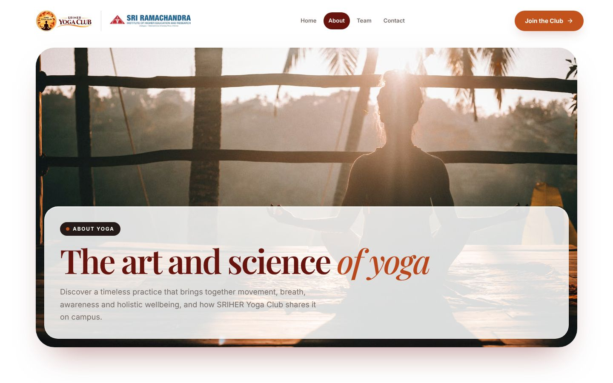
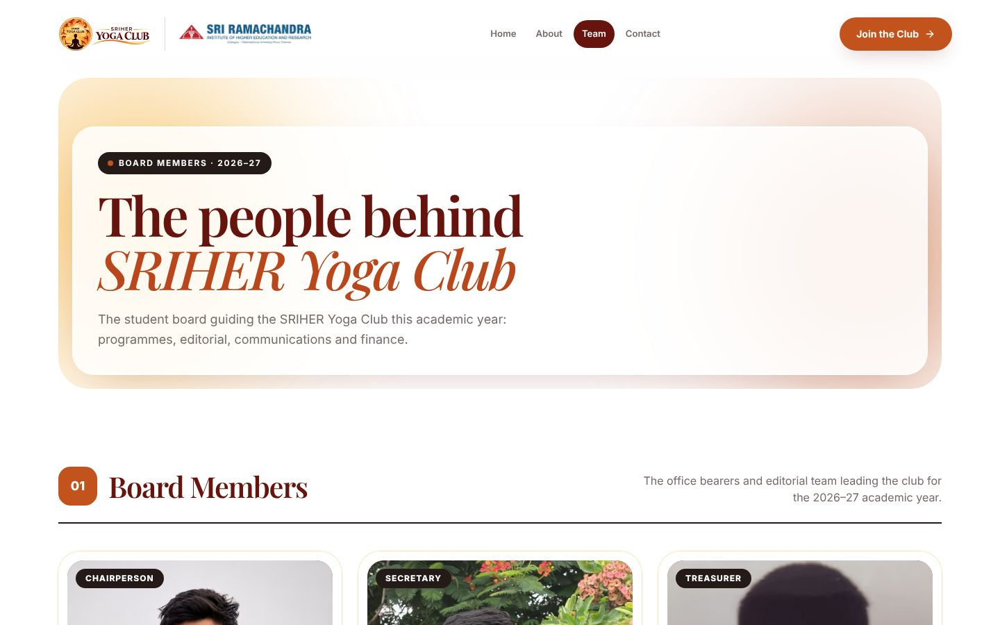
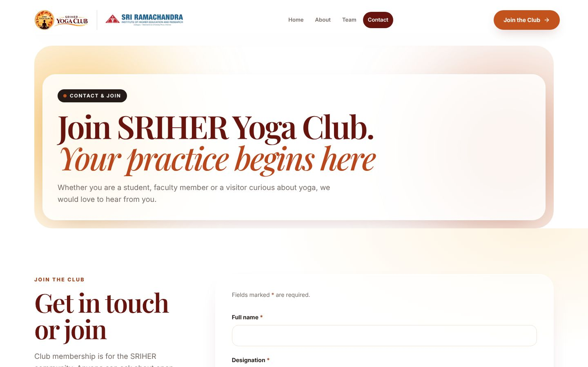

# SRIHER Yoga Club — Official Website

> Website of the **SRIHER Yoga Club**, the yoga, pranayama and meditation community of
> **Sri Ramachandra Institute of Higher Education and Research (SRIHER)**, Porur, Chennai, Tamil Nadu, India.
> Guided practice and evidence-informed wellbeing for students, faculty and staff.

[](https://nextjs.org)
[](https://react.dev)
[](https://www.typescriptlang.org)
[](https://tailwindcss.com)

**Keywords:** SRIHER Yoga Club · Sri Ramachandra yoga club · yoga club Chennai · yoga in Porur ·
college yoga club Chennai · pranayama · meditation · mindfulness · student wellbeing · International Day of Yoga

## What is this?

A fast, mobile-first, SEO-optimised Next.js site that tells visitors what yoga is (meaning, history,
Patanjali's eight limbs, research), introduces the club's team, and lets people join or get in touch.
All content is plain TypeScript data in `/data`, so non-developers can update it without touching components.

## Screenshots

| Home | About | Team | Contact |
| --- | --- | --- | --- |
|  |  |  |  |

**Mobile**

| Home | About | Team | Contact |
| --- | --- | --- | --- |
|  |  |  |  |

Full-page captures for every page and breakpoint are in [`docs/screenshots/`](docs/screenshots).

## Tech stack

Next.js 15 (App Router) · React 19 · TypeScript · Tailwind CSS 4 · Motion · Lucide icons.

## Quick start

```bash
git clone https://github.com/Shriniketh59/sriher-yoga-club.git
cd sriher-yoga-club
npm install
npm run dev        # http://localhost:3000
npm run build && npm start
```

Other scripts: `npm run lint`, `npm run typecheck`.

## Pages

| Route | Contents |
| --- | --- |
| `/` | Cinematic hero, welcome, holistic wellbeing, philosophy, programs, events, science, achievements, gallery preview, join CTA |
| `/about` | Yoga storytelling: meaning, history, why it matters, eight limbs, evidence (with references), about the club |
| `/programs` | Six programs with schedule / venue / registration slots |
| `/events` | Upcoming and past events (auto-sorted by date, revalidated daily) |
| `/team` | Board & coordinator directory, grouped by category and academic year |
| `/wellness-hub` | Filterable articles; `/wellness-hub/[slug]` article pages with references |
| `/gallery` | Masonry grid, album filters, lightbox with keyboard + fullscreen |
| `/contact` | Contact details + accessible "Join the Club" form (`/contact#join`) |

## Updating content — everything lives in `/data`

| File | What to edit |
| --- | --- |
| `data/site.ts` | Email, phone, address, social links, production URL (all marked `PLACEHOLDER`) |
| `data/team.ts` | Members, roles, photos, display order, academic years (instructions at top of file) |
| `data/events.ts` | Events — use ISO dates `YYYY-MM-DD`; remove `placeholder: true` from real ones |
| `data/programs.ts` | Program text; set `schedule`, `venue`, `registration` when confirmed |
| `data/articles.ts` | Wellness Hub articles; set `author` and `publishedOn` once reviewed |
| `data/research.ts` | Evidence summaries and citations |
| `data/achievements.ts` | Verified club milestones |
| `data/gallery.ts` | Gallery photos and album (event) names |
| `data/images.ts` | Photo library — swap stock images for real club photos here |

Pending items render with a visible dashed "To be announced" marker so nothing
unconfirmed is presented as fact.

### Photographs
All current photos in `public/images/stock` are **temporary Unsplash images**
(Unsplash License). They do not depict SRIHER members or events, and the site
says so in the footer, gallery and event cards. To use real photos, add them to
`public/images/club/` and point the entries in `data/images.ts` at them with
`stock: false`.

### Logo
`public/brand/sriher-yoga-club-logo.png` is the official emblem + wordmark,
unchanged apart from a transparent background. `sriher-yoga-club-emblem.png` and
the favicons (`app/icon.png`, `app/apple-icon.png`) are crops of the same file.

### Join form
The form validates input but only submits if a real endpoint is configured.
Copy `.env.example` to `.env.local` and set `NEXT_PUBLIC_JOIN_ENDPOINT` to a
URL that accepts a JSON `POST` (Google Apps Script, Formspree, your own API,
etc.). Until then, after the form passes validation it says plainly that online registration isn't connected yet and offers
a pre-filled email instead. It never shows a fake success message.

### Before launch
- Faculty review of the About page's history/philosophy text and every citation in `data/research.ts`
- Approve or replace the draft Vision / Mission / Objectives on `/about`
- Replace all `PLACEHOLDER` values in `data/site.ts`

## Update — October 2026 redesign

### Home video
`public/videos/` holds the hero video (Mixkit "Woman doing yoga on a deck", Mixkit Stock
Video Free License), re-encoded without audio: 1080p WebM + MP4 for desktop, 720p WebM +
MP4 for phones, and `hero-yoga-poster.jpg`. To use official club footage, replace those
files (same names) or change the paths in `data/media.ts`. Visitors who prefer reduced
motion or use data-saver see the poster only; whenever the video plays, a pause/play
button is shown.

### Events — `data/events.ts`
Empty until real events are confirmed (pages show a designed "no events yet" state).
The file's header comment shows the exact shape. Each event gets its own page at
`/events/<slug>` with WhatsApp share, copy link, native share (phones), an
Add-to-calendar `.ics` download, and schema.org `Event` data for search engines.

### Gallery — `data/gallery.ts`
Authentic club photographs only. Put files in `public/images/gallery/` and add entries;
the gallery, filters and lightbox switch on automatically.

### Join form
Visitors choose Student / Faculty & staff / Public visitor and what they want
(join the club / attend events / general enquiry). It includes a privacy notice and a
hidden anti-spam field. It still needs `NEXT_PUBLIC_JOIN_ENDPOINT` to actually submit.

## SEO & mobile (October 2026)

- **Set the domain:** `NEXT_PUBLIC_SITE_URL=https://your-domain` in the host's env vars. Canonicals,
  Open Graph, `sitemap.xml`, `robots.txt` and JSON-LD all read it (`data/site.ts`). Until set,
  links fall back to `example.org` (or the Vercel production domain).
- **Per-page tags:** `lib/seo.ts` → `pageMetadata()` builds title, description, keywords, canonical,
  Open Graph and Twitter tags for each page. Share images live in `public/og/` (1200×630).
- **Structured data:** `Organization` + `WebSite` graph in `app/layout.tsx`; each page adds
  `WebPage` / `AboutPage` / `ContactPage`, `BreadcrumbList`, and the team page an `ItemList` of `Person`.
- **Indexing:** previews are `noindex` automatically; set `NEXT_PUBLIC_NOINDEX=true` on staging.
  Add Search Console / Bing codes via `NEXT_PUBLIC_GOOGLE_SITE_VERIFICATION` / `NEXT_PUBLIC_BING_SITE_VERIFICATION`.
- **Mobile performance:** hero headings animate with CSS (no JS wait for LCP), the hero video loads
  after the page is idle, parallax is off on touch screens, glass blur is lighter on phones,
  tap targets are ≥44px, safe-area insets are respected and a web app manifest is included.
- After launch: submit `https://your-domain/sitemap.xml` in Google Search Console.
